[README.md](https://github.com/user-attachments/files/34635330/README.md)

# YOUR NAME
### IT Infrastructure · Systems & Networks · Automation

*Comprendre l’infrastructure. Fiabiliser les systèmes. Automatiser ce qui peut l’être.*

---

## Profile

Je m’intéresse à l’infrastructure informatique : les systèmes, les réseaux, les services qui tournent en arrière-plan et les outils qui rendent un environnement fiable et maintenable.

- **Focus :** systèmes, réseaux et administration IT
- **En exploration :** Linux, virtualisation, cloud et automatisation
- **Ma méthode :** comprendre, documenter, tester, sécuriser et améliorer
- **Objectif :** construire des environnements propres, stables et faciles à maintenir

## Infrastructure Toolkit

*Garde uniquement les technologies que tu utilises réellement et ajoute celles que tu apprends.*

## Lab & Projects

> Remplace ces exemples par tes vrais labs ou projets au fil du temps.

- **Home Lab** — environnement de test pour pratiquer l’administration et documenter les configurations.
- **Network Lab** — exercices autour de l’adressage IP, du subnetting, du DNS, du DHCP et du dépannage réseau.
- **Automation** — petits scripts pour automatiser des tâches répétitives et réduire les erreurs manuelles.

## Areas of Interest

| Domaine | Sujets |
| --- | --- |
| Systems | Linux, Windows Server, services, permissions, logs |
| Networks | TCP/IP, VLAN, DNS, DHCP, routage, troubleshooting |
| Virtualization | Machines virtuelles, lab de test, snapshots |
| Automation | Bash, PowerShell, scripts et documentation |
| Security | Mises à jour, moindre privilège, sauvegardes, durcissement de base |

## Working Principles

- **Reliability first** — privilégier des systèmes prévisibles et maintenables.
- **Document everything** — une configuration utile doit pouvoir être comprise et reproduite.
- **Automate carefully** — tester avant de déployer, garder une solution de retour arrière.
- **Keep learning** — progresser par la pratique et les retours d’expérience.

*Understand the systems. Connect the pieces. Keep it reliable.*

---

Remplace <code>YOUR NAME</code> et <code>YOUR-USERNAME</code>, puis adapte les technologies à ton expérience réelle.

